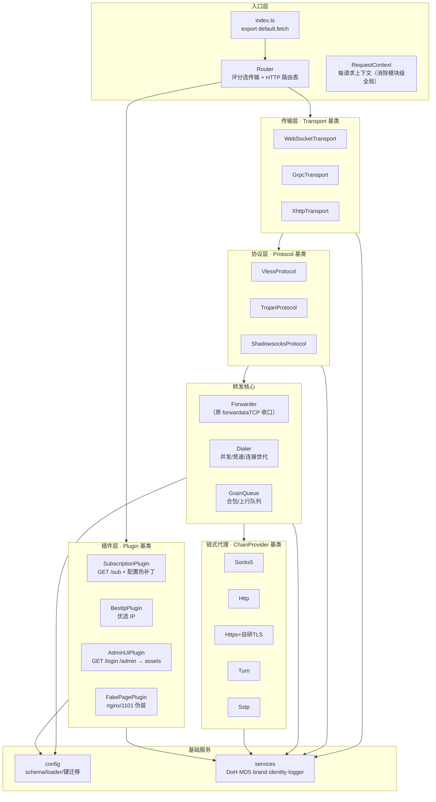

# xtunnel TypeScript 重构架构设计（DESIGN）

> 版本：v1 · 分支：`dev` · 基线：`_worker.js`（Version 2026-10-08 22:23:27）
> 关联：`_worker.js` 文件头「章节索引」（第 7-19 行）—— 本文档是其正式化与扩展。

---

## 1. 设计目标

| 目标 | 设计手段 |
|---|---|
| 增加新协议方便 | `Protocol` 抽象基类 + 注册表评分选择；新协议 = 新子类 + 注册，转发核心零改动 |
| 增加新传输层方便 | `Transport` 抽象基类 + 注册表评分选择；新传输 = 新子类 + 注册，路由零改动 |
| 错误好定位 | 类型化错误 + 分层错误码命名空间（`TRANSPORT_XHTTP_*` 等）+ 每请求 `requestId` 链路日志 |
| 功能好扩展 | `Plugin` 抽象基类 + 三个生命周期钩子；订阅/优选/管理页 UI/伪装页全部插件化 |

五原则落点：**模块化**（一文件一职责，禁止 6000 行单文件）；**标准化**（统一基类、统一错误、统一日志、统一测试）；**面向对象**（四大抽象基类，行为用方法而非散函数）；**可插拔**（注册表 + 插件钩子，增删不改核心）；**组件化**（传输/协议/链式/插件各自成组件目录，可独立测试与替换）。

## 2. 总体架构



分层职责：

| 层 | 职责 | 不做什么 |
|---|---|---|
| 入口层 | 请求评分分发、HTTP 路由、认证、插件调度 | 不碰字节流 |
| 传输层 | HTTP 帧 ↔ 双向字节流（升级/成帧/early data/padding） | 不理解协议语义 |
| 协议层 | 首包嗅探、解析目标地址、流编解码（SS AEAD 等） | 不建立出站连接 |
| 转发核心 | 拨号、重试、世代管理、上下行泵、合包队列 | 不理解协议/传输细节 |
| 链式代理 | 经 SOCKS5/HTTP/HTTPS/TURN/SSTP 到目标的握手 | 不做业务路由 |
| 插件层 | 通过钩子注入路由/配置变换/出站改写 | 不可绕过基类接口 |
| 基础服务 | 配置、加密、DNS、日志等横切能力 | 不含业务分支 |

## 3. 目录结构

```
xtunnel/
├── assets/pages/              # Static Assets：本地化页面（login/admin/noADMIN/noKV）
├── src/
│   ├── index.ts               # export default { fetch }（唯一入口）
│   ├── router.ts              # 传输评分选择 + HTTP 路由表 + 插件调度
│   ├── context.ts             # RequestContext
│   ├── errors.ts              # TunnelError + 错误码
│   ├── registry.ts            # 通用注册表
│   ├── auth.ts                # cookie/密码认证（恒定时间比较）
│   ├── transport/
│   │   ├── base.ts            # abstract Transport + TransportHandle/Session
│   │   ├── websocket.ts
│   │   ├── grpc.ts
│   │   └── xhttp.ts
│   ├── protocol/
│   │   ├── base.ts            # abstract Protocol + ParsedRequest + DuplexCodec
│   │   ├── vless.ts
│   │   ├── trojan.ts
│   │   └── shadowsocks.ts
│   ├── forward/
│   │   ├── forwarder.ts       # runForward（原 forwardataTCP，12 参收敛为对象）
│   │   ├── dialer.ts          # 并发拨号/竞速预连/连接世代
│   │   ├── grain.ts           # GrainBuffer/上行合包/下行发送器
│   │   └── udp.ts             # UDP/DNS 转发（含 Trojan UDP）
│   ├── chain/
│   │   ├── base.ts            # abstract ChainProvider
│   │   ├── socks5.ts  http.ts  https.ts  turn.ts  sstp.ts
│   │   └── tls/               # 自研 TLS 1.2/1.3 客户端（从 https.ts 拆出）
│   ├── plugins/
│   │   ├── base.ts / registry.ts / setup.ts  # abstract Plugin + 注册表 + 启动期注册
│   │   ├── subscription.ts    # fast-sub + GET /sub（含 Clash/Singbox/Surge 热补丁）
│   │   ├── best-ip.ts         # getADDAPI / locations（优选）
│   │   ├── admin-ui.ts        # admin 子 API（log/check/cf/tg/ADD）
│   │   └── fake-page.ts       # nginx / 1101 / 反代伪装页（fallback）
│   ├── config/
│   │   ├── schema.ts          # Config 类型 + 默认值
│   │   ├── loader.ts          # loadConfig（挂 onConfigLoad 钩子）
│   │   └── key-migration.ts   # 中文键 ↔ 英文键迁移（85 对）
│   ├── services/              # doh.ts / md5.ts / brand.ts / identity.ts / bestip.ts / sub-patch.ts 等
│   └── utils/                 # bytes.ts / array.ts / net.ts 等纯函数
├── test/                      # 单测（协议解析、键迁移、配置、认证、插件路由……）
├── archive/                   # 归档对照物：_worker.js + test_rename.mjs（P8 归档）
├── package.json  tsconfig.json  wrangler.toml  README.md  DESIGN.md
```

### 章节索引 → 新模块映射

| `_worker.js` 章节 | 去向 |
|---|---|
| 1 全局常量与品牌常量 | `services/brand.ts` + 各模块本地常量 |
| 2 fetch 主入口 | `index.ts` + `router.ts` + `auth.ts` |
| 3 xHTTP/gRPC/WS 传输层 | `transport/*` |
| 4 协议解析与 SS 加密 | `protocol/*` |
| 5 TCP/UDP 转发核心 | `forward/*` |
| 6 链式代理客户端 | `chain/*` |
| 7 订阅热补丁/配置/DoH/优选/反代 | `plugins/subscription` `plugins/bestip` `config/*` `services/*` |
| 8 HTML 伪装页 | `plugins/fakepage.ts` + `plugins/admin-ui.ts` |

## 4. 核心接口（统一基类签名）

### 4.1 RequestContext —— 消除模块级全局

```ts
// 现状问题：config_JSON / debugLogging / tcpConcurrentDial 等是模块级 let，
// 同 isolate 并发请求互相覆盖。重构后全部收进每请求上下文。
class RequestContext {
  readonly requestId: string;          // 日志链路 ID
  readonly request: Request;
  readonly env: Env;
  readonly ctx: ExecutionContext;
  readonly url: URL;
  readonly ua: string;
  readonly clientIp: string;
  readonly userId: string;             // UUID（env.UUID 或 MD5MD5 派生）
  readonly identity: { header: string; key: string };
  readonly dial: {                     // 每请求调优参数（原模块级三个 let）
    tcpConcurrentDial: number;
    proxyConcurrentDial: number;
    preloadRaceDial: boolean;
    debug: boolean;
  };
  config?: Config;                     // loadConfig 后填充
  log(...args: unknown[]): void;       // 自动携带 requestId
}
```

### 4.2 Transport —— 传输层基类

```ts
interface TransportSession {
  readonly name: string;                       // 'websocket' | 'grpc' | 'xhttp'
  readonly readable: ReadableStream<Uint8Array>; // 客户端 → 边缘（已解帧）
  readonly writable: WritableStream<Uint8Array>; // 边缘 → 客户端（待成帧）
  readonly earlyData?: Uint8Array;              // WS early data / xHTTP 首包
  close(reason?: string): void;
}

interface TransportHandle {
  readonly transport: TransportSession;
  /** 返回给客户端的 HTTP 响应（WS=101，gRPC/xHTTP=流式 200） */
  readonly response: Response;
}

abstract class Transport {
  abstract readonly name: string;
  /** 0 = 不匹配；分高者胜，同分按注册顺序。WS=100，gRPC=80，xHTTP=60（POST 兜底） */
  abstract score(request: Request, ctx: RequestContext): number;
  /** 建立会话；只做 HTTP 层帧处理，不解析协议 */
  abstract accept(request: Request, ctx: RequestContext): Promise<TransportHandle>;
}
```

### 4.3 Protocol —— 协议层基类

```ts
interface ParsedRequest {
  host: string;
  port: number;
  udp: boolean;
  payload: Uint8Array;        // 协议头之后的剩余客户端数据
  replyHeader?: Uint8Array;   // VLESS 响应头 [version,0] 等；SS/Trojan 可无
}

interface DuplexCodec {
  /** 客户端上行 → 发往目标（SS：AEAD 解密；VLESS/Trojan TCP：直通） */
  uplink(chunk: Uint8Array): Uint8Array | Promise<Uint8Array>;
  /** 目标下行 → 发往客户端（SS：AEAD 加密；其余：直通） */
  downlink(chunk: Uint8Array): Uint8Array | Promise<Uint8Array>;
}

abstract class Protocol {
  abstract readonly name: string;
  /** 首包嗅探：0 = 不匹配。hints 携带传输层/URL 线索（如 ?enc= → SS） */
  abstract sniff(first: Uint8Array, hints: SniffHints): number;
  abstract parse(first: Uint8Array, hints: SniffHints): ParsedRequest;
  /** 后续流编解码；默认返回直通实现 */
  codec(hints: SniffHints): DuplexCodec;
}
```

### 4.4 ChainProvider —— 链式代理基类

```ts
interface ChainDialParams {
  proxy: { host: string; port: number; username?: string; password?: string };
  target: { host: string; port: number };
  initialData: Uint8Array;      // 协议首包，代理握手完成后随隧道发出
  tcpConnect: TcpConnector;     // 底层 TCP 工厂（可 mock，便于单测）
}

interface ChainDialResult {
  socket: Socket;               // 已完成代理握手、可直接读写到目标
  head?: Uint8Array;            // 握手期间先行到达的、属于目标响应的字节
}

abstract class ChainProvider {
  abstract readonly name: string;
  abstract dial(params: ChainDialParams): Promise<ChainDialResult>;
}
```

### 4.5 Plugin —— 插件基类

```ts
abstract class Plugin {
  abstract readonly name: string;
  /** 挂 HTTP 路由；返回 null 表示不处理，交还 Router */
  onRoute?(req: RequestContext): Promise<Response | null>;
  /** loadConfig 深拷贝结果上做变换（订阅热补丁、优选注入等） */
  onConfigLoad?(config: Config, ctx: RequestContext): Promise<Config>;
  /** 实际拨号前改写出站计划（可选）；返回新计划或原样 */
  onBeforeDial?(plan: DialPlan, ctx: RequestContext): Promise<DialPlan>;
}
```

内置插件与钩子占用：

| 插件 | 钩子 | 说明 |
|---|---|---|
| SubscriptionPlugin | `onRoute`(GET /sub) + `onConfigLoad` | 原章节 7 的订阅与 Clash/Singbox/Surge 热补丁 |
| BestIpPlugin | `onRoute` + `onConfigLoad` | 优选 API、ADD.txt、随机 IP 池 |
| AdminUiPlugin | `onRoute`(GET /login, GET /admin) | 读 `assets/pages/*.html`，认证复用 `auth.ts`；**替代 4 处 `fetch(PAGES_SITE_URL)`** |
| FakePagePlugin | `onRoute`(兜底) | nginx/1101 伪装页（原章节 8） |

### 4.6 Registry —— 通用注册表

```ts
abstract class Component { abstract readonly name: string; }
class Registry<T extends Component> {
  register(item: T): this;
  get(name: string): T | undefined;
  list(): readonly T[];
}
// 传输/协议用「评分选择」而非按名查找：
function pickBest<T extends { score?(...): number }>(...): T | undefined;
```

### 4.7 错误体系

```ts
class TunnelError extends Error {
  constructor(
    readonly code: string,        // 错误码，见下表
    message: string,
    readonly cause?: unknown,
  ) { super(message); }
}
```

| 命名空间 | 覆盖 | 示例码 |
|---|---|---|
| `TRANSPORT_*` | 传输层 | `TRANSPORT_XHTTP_PADDING_INVALID`、`TRANSPORT_WS_EARLYDATA_DECODE` |
| `PROTOCOL_*` | 协议层 | `PROTOCOL_VLESS_INVALID_HEADER`、`PROTOCOL_SS_DECRYPT` |
| `FORWARD_*` | 转发核心 | `FORWARD_DIAL_TIMEOUT`、`FORWARD_QUEUE_OVERFLOW` |
| `CHAIN_*` | 链式代理 | `CHAIN_SOCKS5_HANDSHAKE`、`CHAIN_TURN_TIMEOUT` |
| `CONFIG_*` | 配置 | `CONFIG_PARSE`、`CONFIG_KEY_MIGRATION` |
| `AUTH_*` | 认证 | `AUTH_COOKIE_INVALID` |
| `PLUGIN_*` | 插件 | `PLUGIN_SUB_RENDER` |

约定：模块内**只抛 `TunnelError`**；Router/会话编排器统一捕获 → `ctx.log` 打印 `requestId + code + cause` → HTTP 路由回错误 JSON，代理会话关闭连接。日志行格式：`[requestId][模块] 消息`。

## 5. 请求生命周期

**代理链路**（WS/gRPC/xHTTP 之一）：

1. `index.ts` 构建 `RequestContext`（env 解析、userId、identity、dial 参数）。
2. `router.ts` 对注册的 Transport 逐个 `score()`，取最高分 `accept()` → 拿到 `TransportHandle`（响应已就绪但先不返回）。
3. 会话编排：读首包（earlyData 优先）→ 各 `Protocol.sniff()` 评分选协议 → `parse()` 得 `ParsedRequest`。
4. 组装 `ForwardRequest`（目标、payload、replyHeader、session、proxy 参数、ctx），调 `runForward()`。
5. Forwarder 经 Dialer 建出站（直连 / ProxyIP / ChainProvider，由 `onBeforeDial` 与反代参数决定），Grain 队列泵上下行。
6. 返回第 2 步的 `response`（101/200），连接在后台续命；错误经统一捕获关闭会话并记日志。

**HTTP 链路**：`router.ts` 查核心路由表（`/version`、`/login` POST、`/admin/*` API、`/logout`、`/locations`、`/robots.txt`、HTTP→HTTPS 重定向）→ 未命中则遍历插件 `onRoute()` → 全 null 则交 `FakePagePlugin` 兜底。认证集中走 `auth.ts`（cookie = `MD5MD5(UA+KEY+ADMIN)`，恒定时间比较）。
## 6. 配置系统

- `config/schema.ts`：`Config` 接口（**英文键**，TS 类型即文档）+ `DEFAULT_CONFIG`。
- `config/key-migration.ts`：`CONFIG_KEY_CN_TO_EN` / `CONFIG_KEY_EN_TO_CN`（85 对，双向零冲突）+ `migrateConfigKeysDeep()` + `toLegacyConfig()`。
- `config/loader.ts`：`loadConfig(env, host, userId, ua)` —— KV 读取 → JSON.parse → 键迁移 → 合并默认值 → 依次执行插件 `onConfigLoad` → 返回**新对象**（不再写模块级 `config_JSON`）。

**兼容红线**：外部管理页（本地化前的 edt-pages、以及任何旧客户端）仍按中文键读写 `admin/config.json`；`GET` 出参必须经 `toLegacyConfig()` 深拷贝转中文键，`POST` 入参必须经 `migrateConfigKeysDeep()` 转英文键后入库。KV 持久化英文键。此层在管理页自制完成前**不可移除**。

## 7. 页面本地化（Static Assets）

现状：`_worker.js` 有 4 处运行时 `fetch(PAGES_SITE_URL + ...)`（L104/L126/L320/L523）。目标：全部改为本地资源。

| 路由 | 现状 | 目标 |
|---|---|---|
| GET `/login` | 远程 `/login`（35KB） | `assets/pages/login.html` |
| GET `/admin`（cookie 通过后） | 远程 `/admin`（980KB） | `assets/pages/admin.html` |
| 无 ADMIN 的 404 页 | 远程 `/noADMIN` | `assets/pages/noADMIN.html` |
| 无 KV 的 404 页 | 远程 `/noKV` | `assets/pages/noKV.html` |

- 页面已在 `https://edt-pages.github.io` 抓取核验：均为单文件自包含 HTML（CSS/JS 内联，无相对路径引用）。
- **外链策略（已定）**：Google Fonts 直接移除（换系统字体栈）；`api.090227.xyz` 等第三方 IP 查询 API 保留原样。UI 重做/砍动画/减体积是本地化完成后的**独立后续工作项**，本次只做来源替换。
- `PAGES_SITE_URL` 常量删除；`env.URL` 伪装页逻辑保留。

### wrangler 配置

```toml
name = "v20251104"
main = "src/index.ts"
compatibility_date = "2025-11-04"
keep_vars = true

[assets]
directory = "./assets"
binding = "ASSETS"          # Worker 内按需读取页面，不走公网
run_worker_first = true     # 路由/认证优先由 Worker 判定，未命中才落静态资源
```

`run_worker_first = true` 是关键：`/admin`、`/login` 必须先过 cookie 认证，不能让静态资源直接应答。AdminUiPlugin 在认证通过后用 `env.ASSETS.fetch(new Request('/pages/admin.html'))` 取页面返回。

**部署方式变化**：必须 `wrangler deploy`（不再支持粘贴单文件到仪表盘）——与 TS 多文件方向一致，dev 分支不影响已部署的生产 Worker，直到用户主动部署。

## 8. 构建与部署

- 工具链：`wrangler`（构建+部署）+ `typescript`（strict）+ `vitest`（单测）。
- `npm run dev` = `wrangler dev`；`npm run deploy` = `wrangler deploy`；`npm test` = `vitest run`；`npm run check` = `tsc --noEmit`。
- 产物：wrangler 用 esbuild 打包 `src/index.ts` → 单模块 Worker；`assets/` 原样上传。
- Node 26 已装（npm 需用 `npm.cmd`，PowerShell 执行策略挡 `npm.ps1`）。

## 9. 测试策略

| 层 | 手段 |
|---|---|
| 协议解析 | `test/protocol/*.test.ts` —— 构造首包字节断言 host/port/udp/payload（现有 `test_rename.mjs` 的向量思路沿用） |
| 配置键迁移 | CN↔EN 往返深比较（键序不敏感）、legacy 中文键 `loadConfig`、GET/POST `admin/config.json` 集成（cookie = `MD5MD5(UA+KEY+ADMIN)`） |
| 传输层 | 首包识别、early data 解码、padding 校验的纯函数单测 |
| 转发/链式 | `tcpConnect` 注入 mock，断言握手字节序列 |
| 回归 | 迁移期保留 `_worker.js` + `test_rename.mjs` 作行为对照；TS 版同用例全绿后才进下一阶段 |

## 10. 迁移阶段（每阶段可独立验收）

| 阶段 | 内容 | 验收 |
|---|---|---|
| P0 脚手架 | `package.json`/`tsconfig`/`wrangler.toml`(assets)、`src/` 空骨架、`assets/pages/` 落 4 个 HTML（去 Google Fonts） | `wrangler dev` 启动；`tsc --noEmit` 过；`/login` 返回本地页 |
| P1 地基 | `context.ts` `errors.ts` `registry.ts` `auth.ts` `services/*` `utils/*` | 单测过；认证恒定时间比较 |
| P2 配置 | `config/*` 三件套 + 插件钩子接线 | `test_rename` 配置用例在 TS 版复刻全绿 |
| P3 协议层 | `protocol/*` 四件套 | 协议单测全绿 |
| P4 传输层 | `transport/*` 四件套 + Router 评分分发 | 三传输冒烟：101/流式握手成功 |
| P5 转发核心 | `forward/*` + 会话编排器（`index.ts` 串起 2–5 步） | **端到端**：真实客户端经 WS/gRPC/xHTTP 连通目标 |
| P6 链式代理 | `chain/*` 五件套 | SOCKS5/HTTP 冒烟；TURN/SSTP 对照原实现字节级一致 |
| P7 插件化 | 订阅/优选/伪装页/管理页 UI 四插件；删 4 处远程 fetch | `test_rename` 25 用例全绿；`/sub` `/admin` 行为与现状一致 |
| P8 收尾 | 清理 `_worker.js` 对照物（归档或删除）、README 更新、`wrangler deploy` 由用户决定 | 全量测试绿；diff 审查 |

依赖关系：P1→P2→P3→P4→P5→P6→P7，P0 先行，P8 最后。P5 是第一个端到端里程碑。

## 11. 兼容红线（全程有效）

1. `admin/config.json` 中文键对外契约（第 6 节）。
2. 认证公式 `cookie = MD5MD5(UA + KEY + ADMIN)`；快速订阅路径、`/version` 校验算法不变。
3. 订阅输出（`/sub` 各 subType、token 日切算法）逐字节兼容。
4. 品牌常量值：`PROXYIP` / `cmliu` / `090227` / `CLUSTER_SUB_UA`（已验证与原运行结果一致）。
5. KV 键名与 `wrangler.toml` 的 `name`、KV binding 名不可改（影响已部署实例）。
6. 不部署、不触碰生产 Worker —— 除非用户明确要求。

## 12. 决策记录

| # | 决策 | 理由 |
|---|---|---|
| D1 | 页面走 Static Assets（`run_worker_first=true`） | 980KB 不进 Worker 脚本；认证仍由 Worker 把控 |
| D2 | 移除 Google Fonts，第三方 IP API 保留 | 字体没必要；IP API 是功能依赖 |
| D3 | UI 重做/砍动画为独立后续项 | 本次目标是来源本地化，不混入 UI 改版 |
| D4 | 链式代理对象化 `ChainProvider` | 与 Transport/Protocol 同构，满足可插拔目标 |
| D5 | 插件仅三个钩子（onRoute/onConfigLoad/onBeforeDial） | 覆盖现有四插件需求，避免过度设计 |
| D6 | `_worker.js` 迁移期保留作对照 | 行为等价可验证；P8 再清理 |
| D7 | 中文键迁移层长期保留（管理页自制前） | 外部兼容红线 |
| D8 | 部署必须 `wrangler deploy` | D1 的代价，与 TS 方向一致 |